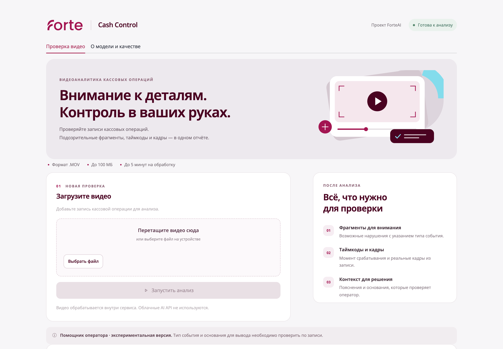

# ForteAI · Cash Control

Локальная видеоаналитика кассовых операций: загрузка записи, очередь обработки,
таймкоды, реальные кадры и структурированный отчёт для проверки оператором.



**Версия приложения: 1.0.1. Активная модель: `typed_v2`** — замороженная
R3D-18 Kinetics-400 и два обученных линейных классификатора.
Выпуск 1.0.1 уточняет запуск и материалы для жюри; веса модели сохранены.

[Демо для жюри](#demo) ·
[Презентация продукта](docs/ForteAI_Cash_Control.pptx) ·
[Готовые веса и выпуск](https://github.com/aib2l2/forte-cash-control/releases/tag/v1.0.1) ·
[Развёртывание](deploy/README.txt)

<a id="demo"></a>

## Демо для жюри

**[Открыть веб-интерфейс](https://stunning-built-carnival-korea.trycloudflare.com/)**

API base URL: `https://stunning-built-carnival-korea.trycloudflare.com`.
К нему добавляются пути `/api/v1/analyze` и `/api/v1/jobs/{job_id}`.

Веб-интерфейс запрашивает логин и пароль. API использует отдельный заголовок
`X-API-Key`. Учётные данные для жюри указываются отдельно в форме заявки и не публикуются в GitHub.

Адрес проверен 18.10.2026. Это временное демо с компьютера команды:
он должен быть включён, подключён к интернету и не переходить в сон.
После перезапуска туннеля адрес может измениться; актуальная ссылка публикуется
в этом разделе. Постоянный сервер и домен пока не настроены.

Кнопка в презентации ведёт в этот раздел. Для самостоятельного запуска
используйте инструкции ниже. В релизах скачивайте **1.0.1** или ветку **main**;
выпуск 1.0.0 сохранён как архив и содержит прежние инструкции доступа.

## Возможности

- Загрузка `.mov` до 100 МБ через интерфейс или API.
- 11 допустимых типов событий из актуальной разметки, без добавления новых категорий.
- Таймкоды, 1–3 реальных JPEG-кадра на событие и пояснение для проверки.
- Справочник нормативных источников с указанием ограничений применимости.
- JSON-отчёт, очередь, отдельные статусы ошибок и API-ключ.
- Локальный анализ без облачных AI API, звука и распознавания лиц.
- Интерфейс в стиле Forte; конфигурация Docker Compose и Caddy для своего сервера.

## Быстрый запуск

Проверенное окружение: macOS arm64, Python 3.13, PyTorch 2.14.1.
Для Windows адаптируйте команды активации окружения. Docker-конфигурация
приложена, но её работа на вашем сервере требует отдельной проверки.

```bash
git clone https://github.com/aib2l2/forte-cash-control.git
cd forte-cash-control
python3.13 -m venv .venv
source .venv/bin/activate
python -m pip install torch==2.14.1 torchvision==0.29.1
python -m pip install -r deploy/requirements-runtime.txt
python scripts/setup_env.py
```

Репозиторий публичный: код, презентацию и веса можно скачать без входа в GitHub.
GitHub CLI не требуется. Приложение запускается на вашем компьютере или сервере.

### Установить веса активной модели

Классификатор и его отчёт входят в Git. Большие веса R3D-18 находятся в Release.
Скачивание выполняется только при установке; анализ видео не требует интернета.

```bash
mkdir -p .downloads
curl --fail --location --retry 3 \
  https://github.com/aib2l2/forte-cash-control/releases/download/v1.0.1/r3d18-kinetics400.zip \
  --output .downloads/r3d18-kinetics400.zip
python -m zipfile -e .downloads/r3d18-kinetics400.zip .
python scripts/verify_model.py
```

Также можно [скачать архив весов в браузере](https://github.com/aib2l2/forte-cash-control/releases/download/v1.0.1/r3d18-kinetics400.zip)
и распаковать его в корень проекта, сохранив структуру `models/cash_r3d/`.

Проверка сверяет SHA-256 обоих файлов модели с отчётом и проверяет словарь типов.
Исходные видео, Excel и кэши обучения для анализа нового видео не нужны.

### Запустить сервис

В первом терминале с активным окружением:

```bash
python -m uvicorn cash_ml.api:app --host 127.0.0.1 --port 8000 --workers 1
```

Во втором терминале с активным окружением:

```bash
python -m streamlit run cash_ml/app.py --server.address 127.0.0.1 --server.port 8501
```

Интерфейс: http://127.0.0.1:8501. API и Swagger: http://127.0.0.1:8000/docs.
В VS Code можно открыть `ForteAI-ML.code-workspace` и запустить оба процесса через F5.

Основные точки запуска: `cash_ml.api:app` и `cash_ml/app.py`. Старые пути
`backend.main:app` и `frontend/app.py` оставлены для совместимости и открывают
тот же сервис typed_v2 с тем же интерфейсом и ограничением времени обработки.

`setup_env.py` создаёт случайный ключ в локальном `.env` и не перезаписывает
существующий. Интерфейс передаёт ключ серверу автоматически. Для внешнего API
передавайте его в заголовке `X-API-Key`. Доступ к веб-интерфейсу на публичном
сервере отдельно защищается логином и паролем Caddy.

## API

| Метод | Адрес | Результат |
|---|---|---|
| POST | `/api/v1/analyze` | multipart-поле `file`; HTTP 202 и `job_id` |
| GET | `/api/v1/jobs/{job_id}` | `processing`, `failed` или `done` с отчётом |
| GET | `/api/v1/model` | Состояние и метаданные активной модели |
| GET | `/api/v1/rules` | Словарь правил и источников |
| GET | `/health` | Доступность процесса; готовность модели проверяется отдельно |

Все методы, кроме `/health`, требуют `X-API-Key`.
При успехе отчёт содержит `verdict` и `violations`. Событие содержит
`type`, `timecode_sec`, `description`, `evidence_frames`. Кадр содержит
`timestamp_sec` и `image_base64` (JPEG без префикса `data:`).

Запускайте один процесс API. До четырёх задач учитываются суммарно в очереди
и обработке. Дедлайн 290 секунд отсчитывается с принятия в очередь.
Ошибка декодирования или тайм-аут дают `failed`, а не `no_violation`.

## Модель и ограничения

Обработка использует 16 кадров на окно до четырёх секунд, признаки R3D-18,
бинарный классификатор и классификатор типов. Имена загруженных файлов и Excel
не используются как признаки при анализе.

Это демонстрационная система помощи оператору, не подтверждённая промышленная
система контроля. Порог срабатывания не равен точности или вероятности нарушения.
Исторические метрики находятся в [отчёте модели](models/cash_r3d/typed_report.json) и не являются
независимой оценкой на новых сеансах. Классы с единичными примерами не имеют
надёжной проверки качества. Итоговое решение принимает человек.

Таймкод относится к доказательному кадру, а не к точной границе действия.
Правомерность доступа человека и применимость нормативного пункта требуют
контекста. Не все категории имеют прямое проверенное нормативное основание.

## Проверки

После установки модели:

```bash
python -m pip install -r cash_ml/requirements.txt
python -m pip install -e '.[dev]'
python -m pytest tests cash_ml -q
python scripts/verify_model.py
```

Тесты проверяют контракт API, очередь, дедлайн, типы, кадры, подготовку данных
и интерфейс. Они не доказывают качество модели на реальных новых видео.
Часть проверок локальных экспериментов пропускается без приватных артефактов.

## Что находится в репозитории

- `cash_ml/` — активный сервис, интерфейс, подготовка признаков, обучение и тесты.
  Исследовательские утилиты сохранены как исходный код; их модели не подключены.
- `backend/` — общие HTTP-маршруты, настройки, схемы и аутентификация.
- `frontend/app.py` — совместимый запуск актуального интерфейса.
- `rules/README.md` — указатель на действующий нормативный справочник.
- `models/cash_r3d/` — активный классификатор и отчёт; веса скачиваются из Release.
- `deploy/` — зависимости, Docker/Caddy, инструкции и сведения о лицензиях.
- `outputs/case_review/legal_sources/` — снимки публичных нормативных источников.
- `docs/` — презентация и снимок интерфейса без пользовательского видео.

Исходные видео, Excel, частные описания сцен, обучающие кэши, временные результаты,
ключи, пароли и локальные окружения не публикуются. Загруженные видео удаляются
после обработки, а JSON и доказательные кадры сохраняются локально в `storage/`;
срок хранения задаётся владельцем развёртывания.

Логотип, шрифты и сторонние компоненты сохраняют свои условия использования:
`cash_ml/assets/SOURCES.txt`, `cash_ml/assets/OpenSans-OFL.txt`, `deploy/third_party/`.
Публикация этого репозитория не предоставляет права на бренд Forte или датасет.
